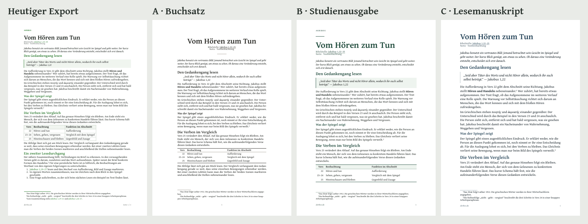

# Schriftbild für den PDF-Export

Vergleich für [Issue #354](https://github.com/akribos-biblestudy/akribos/issues/354). Alle vier PDFs enthalten dieselbe Beispielnotiz zu Jakobus 1,22–25. Sie zeigen jeweils zwei A4-Seiten mit natürlichen Umbrüchen, Bibelzitat, griechischen Wörtern, einer Tabelle, einer Liste und Seitenfußnoten. Die Schriftfamilie Akribos Text bleibt die gemeinsame Grundlage.



| PDF                                         | Schriftbild                                                                              |
| ------------------------------------------- | ---------------------------------------------------------------------------------------- |
| [Heutiger Export](00-heutiger-export.pdf)   | Akribos Studienblatt aus #294 mit 11,2 pt, grünen Überschriften und linksbündigem Text.  |
| [A · Buchsatz](01-buchsatz.pdf)             | 134 mm Satzspiegel, 11,4 pt, Blocksatz mit deutscher Silbentrennung, zentrierter Titel.  |
| [B · Studienausgabe](02-studienausgabe.pdf) | 152 mm Satzspiegel, 11,8 pt, dunkelgrüne Hierarchie und feine Tabellenlinien.            |
| [C · Lesemanuskript](03-lesemanuskript.pdf) | 152 mm Satzspiegel, 13,4 pt, weiterer Zeilenabstand und deutliche Zwischenüberschriften. |

A orientiert sich beim Verhältnis zwischen Satzspiegel und Seitenrändern am [KOMA-Script-Paket `typearea`](https://ctan.org/pkg/typearea). Die schmalere Zeile und der Blocksatz passen zu fortlaufenden Texten. B eignet sich für Ausarbeitungen mit Zitaten und strukturierten Beobachtungen. C erhöht die Schriftgröße und den Zeilenabstand für den Einsatz am Lesepult.

## Mögliche Vorlagenauswahl

In den Benutzereinstellungen könnte eine Auswahl unter „PDF-Export“ die bevorzugte Vorlage speichern. Im Exportmenü wäre eine abweichende Vorlage für den einzelnen Download wählbar. Für die Umsetzung steht zuerst die Stilentscheidung an. Diese Proben betreffen den PDF-Export.

## Reproduktion

Vom Repository-Root aus mit Python 3, Git, Typst 0.15.1, Poppler und ImageMagick 7 ausführen.

```sh
python3 docs/planning/pdf-354/build.py
```

Das Skript setzt [ein gemeinsames Exportmodell](document.json) mit der Produktionsvorlage vom Commit `f1c068c`. Für die drei Entwürfe kombiniert es denselben Inline-Renderer mit [eigenen Typst-Stilen](entwuerfe.typ). Die Schriften kommen aus `data/fonts/pdf`, die Systemschriftensuche ist abgeschaltet. Für die PNG-Vorschau können Poppler- und ImageMagick-Versionen sichtbare Unterschiede verursachen.

Das kurze Bibelzitat stammt aus Luther 1912. Der übrige Beispieltext wurde für diesen Vergleich geschrieben. Die Proben decken normale Textumbrüche ab. Vor einer produktiven Vorlagenauswahl müssen der Export mit langen Fußnoten, Bildern sowie schmalen und mehrseitigen Tabellen und die Verarbeitung von Rechts-nach-links-Schrift gegen die regulären Exporttests geprüft werden.
